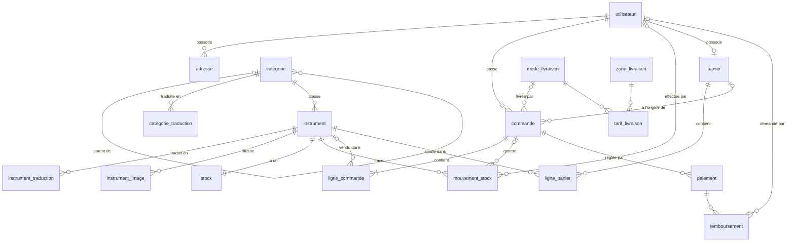
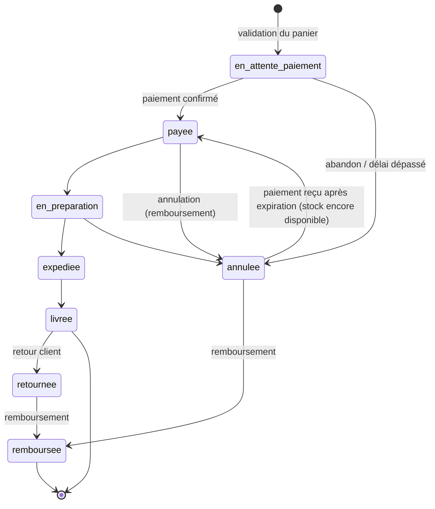

# Schéma de la base de données

> MariaDB 11.4 — `utf8mb4_unicode_ci` — moteur InnoDB — Doctrine ORM (attributs PHP 8)
> Statut : **v1 implémentée** (2026-09-29) — entités dans `src/Entity/`, migration `Version20260929070057`.

## Principes

| Règle | Choix |
|---|---|
| Nommage | tables et colonnes en `snake_case`, singulier (`instrument`, `ligne_commande`) |
| Clés primaires | `id INT UNSIGNED AUTO_INCREMENT` |
| Montants | **entiers en centimes** (`INT`), jamais de `FLOAT` — ex. 149,90 € → `14990` |
| Devise | EUR uniquement (v1) |
| TVA | taux en points de base (`2100` = 21 %) stocké sur l'instrument et **recopié** sur la ligne de commande |
| Dates | `DATETIME` en UTC (`*_at`), type Doctrine `datetime_immutable` |
| Énumérations | `VARCHAR` + PHP `enum` backed (`src/Enum/`), pas d'`ENUM` SQL (migrations plus simples) |
| Multilingue | contenus traduisibles dans des tables `*_traduction` (une ligne par `locale` : `fr`, `en`, `es`…) |
| Historique | une commande **fige** les données au moment de l'achat (adresses, libellés, prix) |
| Booléens | colonne SQL `is_xxx`, propriété PHP `xxx` + méthode `isXxx()` (champ API : `published`, `active`…) |
| Contraintes `CHECK` | ajoutées à la main dans la migration (non générées par Doctrine) |

## Diagramme

## Tables

### Clients et comptes

#### `utilisateur`
Compte client ou administrateur (implémente `UserInterface`).

| Colonne | Type | Contraintes | Note |
|---|---|---|---|
| id | INT UNSIGNED | PK | |
| email | VARCHAR(180) | NOT NULL, **UNIQUE** | identifiant de connexion |
| password | VARCHAR(255) | NOT NULL | hash (algorithme `auto`) |
| roles | JSON | NOT NULL | `["ROLE_USER"]`, `["ROLE_ADMIN"]` |
| prenom | VARCHAR(100) | NOT NULL | |
| nom | VARCHAR(100) | NOT NULL | |
| telephone | VARCHAR(30) | NULL | |
| locale | VARCHAR(5) | NOT NULL, défaut `fr` | langue des e-mails |
| is_verified | TINYINT(1) | NOT NULL, défaut 0 | e-mail confirmé |
| created_at | DATETIME | NOT NULL | |
| updated_at | DATETIME | NOT NULL | |

#### `adresse`
Carnet d'adresses du client.

| Colonne | Type | Contraintes | Note |
|---|---|---|---|
| id | INT UNSIGNED | PK | |
| utilisateur_id | INT UNSIGNED | FK → utilisateur, **ON DELETE CASCADE** | |
| libelle | VARCHAR(50) | NULL | « Maison », « Atelier »… |
| prenom, nom | VARCHAR(100) | NOT NULL | destinataire |
| societe | VARCHAR(150) | NULL | |
| rue | VARCHAR(255) | NOT NULL | |
| complement | VARCHAR(255) | NULL | |
| code_postal | VARCHAR(20) | NOT NULL | |
| ville | VARCHAR(100) | NOT NULL | |
| pays | CHAR(2) | NOT NULL | ISO 3166-1 (`BE`, `FR`…) |
| is_default | TINYINT(1) | NOT NULL, défaut 0 | |

### Catalogue

#### `categorie`
Arborescence (ex. *Cordes › Cordes pincées › Luths*).

| Colonne | Type | Contraintes | Note |
|---|---|---|---|
| id | INT UNSIGNED | PK | |
| parent_id | INT UNSIGNED | FK → categorie, NULL, **ON DELETE RESTRICT** | racine si NULL |
| position | SMALLINT | NOT NULL, défaut 0 | ordre d'affichage |
| is_active | TINYINT(1) | NOT NULL, défaut 1 | |

#### `categorie_traduction`

| Colonne | Type | Contraintes |
|---|---|---|
| id | INT UNSIGNED | PK |
| categorie_id | INT UNSIGNED | FK → categorie, ON DELETE CASCADE |
| locale | VARCHAR(5) | NOT NULL |
| nom | VARCHAR(100) | NOT NULL |
| slug | VARCHAR(120) | NOT NULL |
| description | TEXT | NULL |

Index uniques : `(categorie_id, locale)`, `(locale, slug)`.

#### `instrument`
Données non traduisibles de l'instrument.

| Colonne | Type | Contraintes | Note |
|---|---|---|---|
| id | INT UNSIGNED | PK | |
| categorie_id | INT UNSIGNED | FK → categorie, NOT NULL, **ON DELETE RESTRICT** | |
| reference | VARCHAR(30) | NOT NULL, **UNIQUE** | SKU interne, ex. `CRD-OUD-0042` |
| pays_origine | CHAR(2) | NULL | ISO 3166-1 |
| region_origine | VARCHAR(100) | NULL | ex. « Anatolie », « Bretagne » |
| facteur | VARCHAR(150) | NULL | luthier / atelier |
| annee_fabrication | SMALLINT | NULL | approximative pour les pièces anciennes |
| etat | VARCHAR(20) | NOT NULL | enum `EtatInstrument` : `neuf`, `occasion`, `ancien`, `restaure` |
| is_piece_unique | TINYINT(1) | NOT NULL, défaut 0 | pièce de collection (stock max 1) |
| prix_ht | INT UNSIGNED | NOT NULL | centimes |
| taux_tva | SMALLINT UNSIGNED | NOT NULL, défaut 2100 | points de base |
| regime_tva | VARCHAR(20) | NOT NULL, défaut `normal` | enum `RegimeTva` : `normal`, `marge_occasion`, `marge_antiquite`, `marge_art` (régime de la marge : aucune TVA visible, voir prepare/06 § 1.2) |
| prix_achat | INT UNSIGNED | NULL | centimes TTC ; **back-office seulement**, jamais exposé par l'API ; obligatoire sous le régime de la marge |
| poids_grammes | INT UNSIGNED | NULL | calcul des frais de port |
| dimensions | VARCHAR(100) | NULL | texte libre, ex. `78 × 36 × 18 cm` |
| is_published | TINYINT(1) | NOT NULL, défaut 0 | visible sur le site |
| created_at, updated_at | DATETIME | NOT NULL | |

Index : `(is_published, categorie_id)`, `pays_origine`.

#### `instrument_traduction`

| Colonne | Type | Contraintes |
|---|---|---|
| id | INT UNSIGNED | PK |
| instrument_id | INT UNSIGNED | FK → instrument, ON DELETE CASCADE |
| locale | VARCHAR(5) | NOT NULL |
| nom | VARCHAR(150) | NOT NULL |
| slug | VARCHAR(170) | NOT NULL |
| description_courte | VARCHAR(300) | NULL |
| description | TEXT | NULL |
| materiaux | VARCHAR(255) | NULL |
| histoire | TEXT | NULL |

Index uniques : `(instrument_id, locale)`, `(locale, slug)`.

`histoire` porte le contexte culturel de l'instrument, qui intéresse ce public.

#### `instrument_image`

| Colonne | Type | Contraintes | Note |
|---|---|---|---|
| id | INT UNSIGNED | PK | |
| instrument_id | INT UNSIGNED | FK → instrument, ON DELETE CASCADE | |
| fichier | VARCHAR(255) | NOT NULL | chemin relatif sous `public/uploads/instruments/` |
| alt | VARCHAR(255) | NULL | texte alternatif (accessibilité) |
| position | SMALLINT | NOT NULL, défaut 0 | 0 = image principale |

### Stocks

#### `stock`
État courant, **un seul enregistrement par instrument**.

| Colonne | Type | Contraintes | Note |
|---|---|---|---|
| id | INT UNSIGNED | PK | |
| instrument_id | INT UNSIGNED | FK → instrument, **UNIQUE**, ON DELETE CASCADE | |
| quantite | INT | NOT NULL, défaut 0 | physiquement en stock |
| quantite_reservee | INT | NOT NULL, défaut 0 | bloquée par des commandes non expédiées |
| seuil_alerte | INT | NOT NULL, défaut 1 | notification admin si disponible ≤ seuil |
| emplacement | VARCHAR(50) | NULL | ex. `Réserve A-3` |
| version | INT | NOT NULL, défaut 1 | **verrou optimiste** Doctrine (`#[Version]`) |
| updated_at | DATETIME | NOT NULL | |

Contraintes `CHECK` : `quantite >= 0`, `quantite_reservee >= 0`, `quantite_reservee <= quantite`.
Quantité disponible à la vente = `quantite - quantite_reservee` (calculée, non stockée).

#### `mouvement_stock`
Journal **immuable** de toutes les variations (audit, inventaire).

| Colonne | Type | Contraintes | Note |
|---|---|---|---|
| id | INT UNSIGNED | PK | |
| instrument_id | INT UNSIGNED | FK → instrument, **ON DELETE RESTRICT** | |
| type | VARCHAR(20) | NOT NULL | enum `TypeMouvementStock` |
| quantite | INT | NOT NULL | signée : `+` entrée, `-` sortie |
| commande_id | INT UNSIGNED | FK → commande, NULL, ON DELETE SET NULL | si lié à une vente |
| utilisateur_id | INT UNSIGNED | FK → utilisateur, NULL, ON DELETE SET NULL | auteur (admin) |
| commentaire | VARCHAR(255) | NULL | |
| created_at | DATETIME | NOT NULL | |

Types : `entree` (réception), `reservation`, `liberation` (annulation), `sortie` (expédition), `ajustement` (inventaire, casse), `retour`.
Index : `(instrument_id, created_at)`.

### Commandes

#### `commande`

| Colonne | Type | Contraintes | Note |
|---|---|---|---|
| id | INT UNSIGNED | PK | |
| numero | VARCHAR(20) | NOT NULL, **UNIQUE** | `CMD-{année}-{id sur 6 chiffres}` |
| utilisateur_id | INT UNSIGNED | FK → utilisateur, **NULL** (commande invité), **ON DELETE RESTRICT** | obligations comptables |
| email | VARCHAR(180) | NOT NULL | e-mail du compte, ou saisi par l'invité |
| telephone | VARCHAR(30) | NULL | |
| jeton_suivi | BINARY(16) | NOT NULL, **UNIQUE** | UUID v4 aléatoire du lien « suivre ma commande » (`?jeton=`) |
| expire_at | DATETIME | NULL | fin de la réservation du stock tant que la commande n'est pas payée (30 min) |
| cgv_version, cgv_acceptees_at | VARCHAR(30), DATETIME | NULL | preuve de l'acceptation des CGV |
| canal | VARCHAR(20) | NOT NULL, défaut `site` | |
| mode_livraison_id | INT UNSIGNED | FK → mode_livraison, NULL, ON DELETE SET NULL | |
| libelle_livraison | VARCHAR(100) | NULL | copie du nom du mode |
| panier_id | INT UNSIGNED | FK → panier, NULL, ON DELETE SET NULL | une nouvelle commande du même panier annule la précédente non payée |
| cle_idempotence | VARCHAR(64) | NULL, **UNIQUE** | en-tête `Idempotency-Key` (double envoi) |
| statut | VARCHAR(30) | NOT NULL | enum `StatutCommande` |
| adresse_livraison | JSON | NOT NULL | **copie figée** de l'adresse |
| adresse_facturation | JSON | NOT NULL | copie figée |
| total_ht | INT UNSIGNED | NOT NULL | centimes, somme des lignes |
| total_tva | INT UNSIGNED | NOT NULL | centimes |
| frais_port_ttc | INT UNSIGNED | NOT NULL, défaut 0 | centimes |
| total_ttc | INT UNSIGNED | NOT NULL | centimes, frais de port inclus |
| locale | VARCHAR(5) | NOT NULL | langue du client lors de la commande |
| commentaire_client | TEXT | NULL | |
| numero_suivi | VARCHAR(100) | NULL | transporteur |
| created_at | DATETIME | NOT NULL | |
| paid_at, shipped_at, delivered_at, cancelled_at | DATETIME | NULL | horodatage des étapes |
| motif_annulation | VARCHAR(20) | NULL | enum `MotifAnnulation` : `expiree`, `remplacee`, `annulee` ; décide du sort d'un paiement reçu après l'annulation |

Index : `(utilisateur_id, created_at)`, `(statut, created_at)`, `(statut, expire_at)` (tâche d'expiration).

#### `ligne_commande`
Chaque ligne **recopie** libellé, référence et prix : une modification ou suppression d'instrument ne change pas les commandes passées.

| Colonne | Type | Contraintes | Note |
|---|---|---|---|
| id | INT UNSIGNED | PK | |
| commande_id | INT UNSIGNED | FK → commande, ON DELETE CASCADE | |
| instrument_id | INT UNSIGNED | FK → instrument, NULL, **ON DELETE SET NULL** | |
| reference | VARCHAR(30) | NOT NULL | copie |
| libelle | VARCHAR(150) | NOT NULL | copie du nom dans la locale de la commande |
| prix_unitaire_ht | INT UNSIGNED | NOT NULL | copie, centimes |
| taux_tva | SMALLINT UNSIGNED | NOT NULL | copie |
| quantite | SMALLINT UNSIGNED | NOT NULL | `CHECK (quantite > 0)` |
| total_ht | INT UNSIGNED | NOT NULL | `prix_unitaire_ht × quantite` |
| prix_unitaire_ttc | INT UNSIGNED | NOT NULL | arrondi(`prix_unitaire_ht × (1 + taux)`), comme le panier |
| total_ttc | INT UNSIGNED | NOT NULL | `prix_unitaire_ttc × quantite` ; TVA de la ligne = `total_ttc − total_ht` |
| regime_tva | VARCHAR(20) | NOT NULL, défaut `normal` | copie ; sous le régime de la marge, `prix_unitaire_ht = prix_unitaire_ttc` et `total_ht = total_ttc` (TVA visible nulle) |
| tva_marge | INT | NULL | régime de la marge : TVA due sur la marge, `(total_ttc − prix_achat × quantite) × taux / (1 + taux)`, pour la comptabilité seulement |

### Livraison

Grille **zone × mode × classe de colis** (décision D9, `prepare/05-livraison.md`), administrée dans EasyAdmin. Un seul envoi par commande, tarifé avec la **plus grande classe** des instruments (`instrument.classe_livraison` : `petit_colis` < `colis` < `hors_norme` ; `transport_dedie` → sur devis, `retrait_uniquement` → retrait seul). Valeurs de départ insérées par la migration, **à ajuster**.

| Table | Colonnes | Note |
|---|---|---|
| `zone_livraison` | id, code (UNIQUE), nom, pays (JSON, codes ISO) | un pays dans une seule zone (`PaysDansUneSeuleZone`) |
| `mode_livraison` | id, code (UNIQUE), nom, description, is_retrait, is_active, position | un mode « retrait » est gratuit, sans grille ni adresse de livraison |
| `tarif_livraison` | id, zone_id, mode_id, classe, prix_ttc, delai_jours_min, delai_jours_max | UNIQUE `(zone_id, mode_id, classe)` ; pas de ligne = combinaison non proposée |

### Panier

Panier en base (décision D1, `prepare/01-panier.md`). Aucun prix n'y est figé : les montants sont recalculés à chaque lecture par `App\Service\Panier\CalculateurPanier`.

#### `panier`

| Colonne | Type | Contraintes | Note |
|---|---|---|---|
| id | INT UNSIGNED | PK | jamais exposé |
| jeton | BINARY(16) | NOT NULL, **UNIQUE** | UUID v7, valeur du cookie `panier` (HttpOnly, SameSite=Lax, 30 jours) |
| utilisateur_id | INT UNSIGNED | FK → utilisateur, NULL, **UNIQUE**, ON DELETE CASCADE | NULL = visiteur ; un seul panier par client |
| locale | VARCHAR(5) | NOT NULL | langue des libellés |
| relance_envoyee_at | DATETIME | NULL | relance de panier abandonné (phase 5) |
| created_at, updated_at | DATETIME | NOT NULL | `updated_at` modifié à chaque changement de ligne |

Index : `updated_at` (purge quotidienne des paniers visiteurs inactifs depuis 30 jours).

#### `ligne_panier`

| Colonne | Type | Contraintes | Note |
|---|---|---|---|
| id | INT UNSIGNED | PK | identifiant des routes `/api/panier/lignes/{id}` |
| panier_id | INT UNSIGNED | FK → panier, ON DELETE CASCADE | |
| instrument_id | INT UNSIGNED | FK → instrument, ON DELETE CASCADE | |
| quantite | SMALLINT UNSIGNED | NOT NULL | `CHECK (quantite > 0)`, au plus 10, 1 pour une pièce unique |
| prix_ht_ajout | INT UNSIGNED | NOT NULL | centimes, sert uniquement à signaler un changement de prix |
| created_at | DATETIME | NOT NULL | |

Index unique : `(panier_id, instrument_id)`. L'ajout au panier **ne réserve pas** le stock : la réservation a lieu au passage en commande.

### Paiement

Phase 3 (`prepare/03-paiement.md`, décisions D4 à D6). Le statut d'un paiement ne fait foi qu'une fois **relu chez le prestataire** (`App\Service\Paiement\SynchronisationPaiement`), jamais sur la parole du client ni sur la seule notification. Toutes les dates sont stockées en **UTC** (type Doctrine `App\Doctrine\Type\DateTimeImmutableUtcType`, qui remplace `datetime_immutable`).

#### `paiement`

| Colonne | Type | Contraintes | Note |
|---|---|---|---|
| id | INT UNSIGNED | PK | sert aussi de référence à la communication structurée |
| commande_id | INT UNSIGNED | FK → commande, ON DELETE RESTRICT | une commande peut avoir **plusieurs tentatives** |
| prestataire | VARCHAR(20) | NOT NULL | enum `PrestatairePaiement` : `mollie`, `simulation` (dev et test), `virement` |
| moyen | VARCHAR(30) | NULL | moyen réellement utilisé (`bancontact`, `creditcard`, `paypal`, `virement`…) |
| id_externe | VARCHAR(100) | NULL, **UNIQUE** | `tr_…` chez Mollie |
| url_paiement | VARCHAR(500) | NULL | page du prestataire, réutilisée 10 min (double clic) |
| montant | INT UNSIGNED | NOT NULL, CHECK > 0 | centimes, copié de `commande.total_ttc` (jamais envoyé par le client) |
| devise | CHAR(3) | NOT NULL, défaut `EUR` | |
| montant_rembourse | INT UNSIGNED | NOT NULL, défaut 0, CHECK ≤ montant | |
| statut | VARCHAR(30) | NOT NULL | enum `StatutPaiement` : `ouvert`, `en_attente`, `autorise`, `paye`, `echoue`, `annule`, `expire`, `rembourse`, `partiellement_rembourse` |
| reference_virement | VARCHAR(21) | NULL, **UNIQUE** | communication structurée belge `+++123/4567/89002+++` (modulo 97) |
| donnees | JSON | NULL | informations non sensibles du prestataire (libellé et pays de la carte, anomalie) ; **jamais** de numéro de carte |
| created_at, updated_at | DATETIME | NOT NULL | |
| paye_at | DATETIME | NULL | |

Index : `(statut, created_at)` (synchronisation planifiée).

#### `remboursement`

| Colonne | Type | Contraintes | Note |
|---|---|---|---|
| id | INT UNSIGNED | PK | |
| paiement_id | INT UNSIGNED | FK → paiement, ON DELETE RESTRICT | |
| montant | INT UNSIGNED | NOT NULL, CHECK > 0 | centimes |
| motif | VARCHAR(255) | NOT NULL | |
| id_externe | VARCHAR(100) | NULL, **UNIQUE** | `re_…` chez Mollie |
| statut | VARCHAR(20) | NOT NULL | `a_effectuer` → `en_cours` → `effectue`, ou `echoue` (refus définitif, virement à rembourser à la main) |
| erreur | VARCHAR(255) | NULL | dernière erreur du prestataire |
| utilisateur_id | INT UNSIGNED | FK → utilisateur, NULL, ON DELETE SET NULL | administrateur ; NULL = remboursement automatique |
| created_at | DATETIME | NOT NULL | |
| effectue_at | DATETIME | NULL | |

Un remboursement est **enregistré** dans la transaction qui le décide, puis **envoyé** au prestataire après la validation : une panne réseau ne perd jamais un remboursement dû (la synchronisation planifiée le relance).

#### `evenement_webhook`

Journal des notifications reçues (`prestataire`, `reference`, `charge_utile` JSON, `recu_at`, `traite_at`, `erreur`). Index sur `reference`. Mollie n'envoie que l'identifiant du paiement, sans identifiant d'événement : l'idempotence repose sur le traitement (statut relu et appliqué une seule fois, sous verrou), pas sur ce journal.

### Facturation

Phase 4, **hypothèses à valider avec le comptable** (`App\Service\Facturation\EmissionFacture`) : factures produites par le site, TVA belge pour toutes les ventes (pas d'OSS), frais de port au taux normal (21 %) sauf commande entièrement sous régime de la marge.

#### `facture`

| Colonne | Type | Contraintes | Note |
|---|---|---|---|
| id | INT UNSIGNED | PK | |
| numero | VARCHAR(20) | NOT NULL, **UNIQUE** | `F2026-000001` (facture), `NC2026-000001` (note de crédit) : continu, sans trou, par série et par année |
| type | VARCHAR(20) | NOT NULL | enum `TypeFacture` : `facture`, `note_credit` |
| commande_id | INT UNSIGNED | FK → commande, ON DELETE RESTRICT | une facture par commande, plus ses notes de crédit |
| facture_origine_id | INT UNSIGNED | FK → facture, NULL, ON DELETE RESTRICT | note de crédit : facture corrigée |
| remboursement_id | INT UNSIGNED | FK → remboursement, NULL, ON DELETE SET NULL | note de crédit : remboursement documenté |
| date_emission | DATETIME | NOT NULL | |
| locale | VARCHAR(5) | NOT NULL | langue du PDF (celle de la commande) |
| vendeur, client | JSON | NOT NULL | **copies figées** (nom, adresse, n° de TVA, e-mail, IBAN) |
| lignes | JSON | NOT NULL | lignes figées (référence, libellé, quantité, prix unitaire HTVA, taux ou NULL sous le régime de la marge, totaux, régime) ; frais de port en ligne `PORT` |
| ventilation_tva | JSON | NOT NULL | `[{taux, base, tva}]`, régime normal seulement |
| mentions | JSON | NOT NULL | clés de traduction (`mention.marge_occasion`…) imprimées en bas du PDF |
| total_ht, total_tva, total_ttc | INT UNSIGNED | NOT NULL, CHECK `total_ht + total_tva = total_ttc` | centimes, toujours positifs |
| payee_at, moyen_paiement | DATETIME, VARCHAR(30) | NULL | « Facture acquittée le … par … » |
| motif | VARCHAR(255) | NULL | note de crédit |

Une facture émise n'est **jamais modifiée ni supprimée** ; un remboursement donne une note de crédit (intégrale : copie des lignes ; partielle : TVA au prorata de la facture d'origine). Le PDF (dompdf, `templates/factures/facture.html.twig`, traduit en français, anglais et espagnol) est produit à la demande à partir de ces seules données.

#### `sequence_facture`

`(serie, annee)` en clé primaire, `dernier_numero`. Incrémenté sous verrou (`SELECT … FOR UPDATE`) dans la transaction qui émet la facture (`NumerotationFacture`) : une émission annulée rend son numéro.

## Cycle de vie d'une commande et effets sur le stock

| Transition | Effet sur `stock` | `mouvement_stock` |
|---|---|---|
| → `en_attente_paiement` | `quantite_reservee += n` | `reservation` |
| → `annulee` (avant expédition) | `quantite_reservee -= n` | `liberation` |
| → `expediee` | `quantite -= n`, `quantite_reservee -= n` | `sortie` |
| → `retournee` | `quantite += n` (si revendable) | `retour` |
| → `remboursee` | aucun (le stock a déjà été remis à jour) | — |
| `annulee` → `payee` (`payer_apres_expiration`) | `quantite_reservee += n` | `reservation` |

Transitions Workflow : `payer`, `expirer`, `payer_apres_expiration`, `annuler`, `preparer`, `expedier`, `livrer`, `retourner`, `rembourser`. `remboursee` est l'état final des commandes annulées après paiement ou retournées.

Règles :
- Les transitions passent par **Symfony Workflow** (`config/packages/workflow.yaml`), jamais par une modification directe du statut.
- Toute écriture sur `stock` se fait dans **une transaction** avec le verrou optimiste, et crée le `mouvement_stock` correspondant. Le panier est vérifié contre la quantité disponible lors de la validation.
- Commandes `en_attente_paiement` non payées : libérées automatiquement après **30 min**, ou **5 jours ouvrables** quand le client choisit le virement (tâche planifiée `ExpirerCommandes`, toutes les 5 minutes).
- Transitions `payer` et `payer_apres_expiration` : la facture est émise dans la même transaction (`FactureCommandeListener`) et jointe à l'e-mail « Paiement reçu ».
- Une commande payée ne s'annule plus par le bouton « Annuler » du back-office : le formulaire « Rembourser » (`RemboursementCommande`) rembourse (total ou partiel), annule si demandé (avant expédition), passe en `remboursee` quand tout est rendu et émet la note de crédit.
- Paiement confirmé (`App\Service\Paiement\EncaissementPaiement`, sous verrou de la commande) : commande en attente → `payer` ; commande expirée → `payer_apres_expiration` si le stock suffit encore, sinon `rembourser` et remboursement intégral ; commande annulée pour un autre motif → remboursement ; commande déjà payée → paiement en double remboursé ; montant ou devise différents → rien n'est appliqué (anomalie journalisée, niveau `critical`, canal `paiement`).
- Paiements en ligne restés en cours (notification perdue) : relus chez le prestataire toutes les 15 minutes (`SynchroniserPaiements`), qui relance aussi les remboursements non envoyés.

## Hors périmètre v1 (évolutions prévues)

- **Codes promo**, **avis clients**, **liste de souhaits**.

## Exposition via l'API (API Platform)

État v1 : **`/api/categories`**, **`/api/instruments`** et le **panier courant** (`/api/panier`, `/api/panier/lignes`) sont exposés (formats JSON et JSON-LD).
Le filtrage public (instruments publiés, catégories actives) est fait par `src/Doctrine/CatalogueVisibleExtension.php`.
Les autres ressources seront exposées avec les voters et le Workflow de commande.

| Ressource | Lecture | Écriture |
|---|---|---|
| Catégories, instruments publiés, images | public | `ROLE_ADMIN` |
| Stock (disponibilité) | public : champ calculé `disponible` uniquement | `ROLE_ADMIN` |
| Options de livraison (`/api/panier/livraison?pays=`) | détenteur du panier | — |
| Commandes (`/api/commandes`) | client connecté (ses commandes), ou lien de suivi `?jeton=` (`CommandeVoter`) ; 404 sinon | création : invité ou client, depuis le panier courant, 10 par 10 min et par IP |
| Paiement (`/api/commandes/{numero}/paiements`, `/verification-paiement`) | — | mêmes droits que la lecture de la commande ; montant toujours celui de la commande ; 10 demandes par 10 min et 30 vérifications par minute, par IP |
| Notification Mollie (`POST /api/webhooks/mollie`) | — | publique, sans CSRF : seul l'identifiant est lu, le statut est relu chez Mollie ; 120 par minute et par IP |
| Paiement simulé (`/api/paiements/simulation/{id}`) | hors production seulement (404 en prod) | idem |
| Paiements (back-office) | `ROLE_ADMIN` (lecture seule) | « Virement reçu » sur la commande, avec jeton CSRF |
| Factures PDF (`/api/commandes/{numero}/factures/{facture}.pdf`) | mêmes droits que la commande (client, lien de suivi `?jeton=`, administrateur) ; 404 sinon | — |
| Factures (back-office) | `ROLE_ADMIN` (lecture seule, PDF) | notes de crédit par « Rembourser » sur la commande |
| Panier (`/api/panier`) | détenteur du cookie ou client connecté (`PanierVoter`) | idem ; quantités seulement, jamais de prix ; ajout limité à 30 par minute et par IP |
| Mouvements de stock | `ROLE_ADMIN` | `ROLE_ADMIN` (création seule) |
| Commandes (back-office) | `ROLE_ADMIN` | statut : `ROLE_ADMIN` via les transitions du Workflow |
| Utilisateur, adresses | propriétaire (voter) | propriétaire |

Les entités ne sont pas exposées directement : les lectures publiques passent par des **DTO / groupes de sérialisation**, pour ne jamais exposer l'emplacement en réserve, les quantités exactes, le `password` ou les `roles`.
