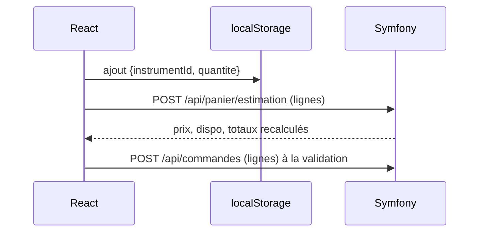
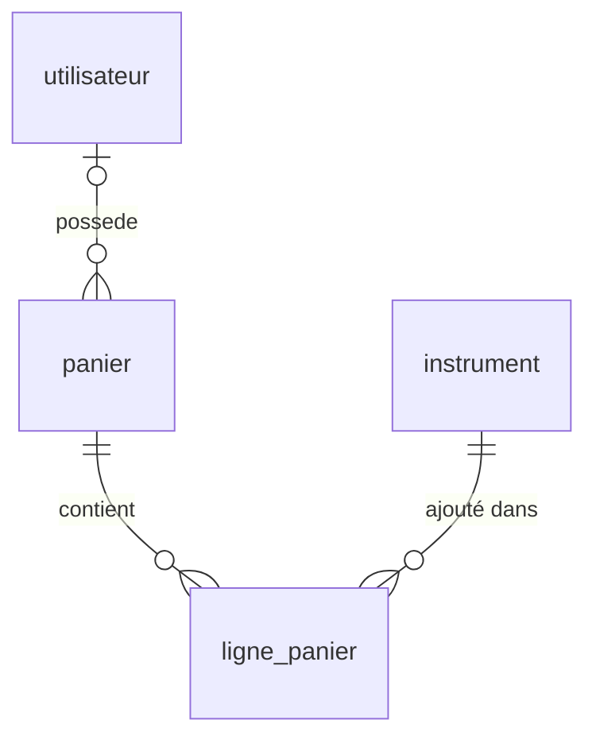

# 01 — Le panier

## 1. Ce que doit faire le panier

- Ajouter, modifier la quantité ou retirer un instrument, et vider le panier.
- Afficher en direct le **prix TTC**, la **disponibilité** et les **frais de port estimés**.
- Fonctionner **sans compte** (visiteur) et **suivre le client** quand il se connecte.
- Gérer le cas des **pièces uniques** (`is_piece_unique`, stock maximal de 1) : quantité bloquée à 1 et message clair si la pièce n'est plus disponible.
- Gérer un **prix modifié** entre l'ajout et la commande : le client doit le voir avant de payer.
- Rester **multilingue** : le libellé vient de `instrument_traduction` dans la locale courante, il n'est jamais enregistré dans le panier.

Règle de sécurité : **le navigateur n'envoie que des identifiants et des quantités**. Les prix, la TVA, les frais de port et les totaux sont **toujours recalculés par le serveur**.

## 2. Les quatre options de stockage

### Option A — Panier 100 % navigateur (`localStorage`)

C'est la piste notée « hors périmètre v1 » dans `database-schema.md`.



| + | − |
|---|---|
| Rien à ajouter en base, très simple | Panier perdu en changeant d'appareil ou de navigateur |
| Aucune charge serveur pendant la navigation | Impossible de relancer un panier abandonné |
| Fonctionne hors ligne | Prix affichés potentiellement périmés (appel d'estimation obligatoire) |
| | Aucune statistique (« combien de paniers contiennent ce oud ? ») |

Convient pour un **prototype** ou un catalogue avec très peu de ventes.

### Option B — Panier en session Symfony

Le panier est un tableau stocké dans la session PHP (le cookie de session existe déjà grâce à `context: session_utilisateur`).

| + | − |
|---|---|
| Aucune nouvelle table | Démarre une session pour **chaque visiteur**, y compris les robots (aujourd'hui le firewall est `lazy`) |
| Rattachement automatique à l'utilisateur connecté | Perdu à l'expiration de la session ou à la déconnexion |
| | Sessions en fichiers sur le VPS : rien n'est partagé si l'hébergement évolue |
| | Pas d'analyse ni de relance possible |

Option **peu recommandée** avec une SPA qui appelle une API.

### Option C — Panier en base de données ✅ recommandé

Deux tables, `panier` et `ligne_panier`. Le visiteur est reconnu par un **jeton aléatoire** (UUID v7) placé dans un cookie `panier` (`HttpOnly`, `Secure`, `SameSite=Lax`, durée 30 jours). Le client connecté est reconnu par `utilisateur_id`.



#### `panier`
| Colonne | Type | Contraintes | Note |
|---|---|---|---|
| id | INT UNSIGNED | PK | |
| jeton | BINARY(16) | NOT NULL, **UNIQUE** | UUID v7, valeur du cookie (jamais l'`id`) |
| utilisateur_id | INT UNSIGNED | FK → utilisateur, NULL, ON DELETE CASCADE | NULL = visiteur |
| locale | VARCHAR(5) | NOT NULL | |
| pays_livraison | CHAR(2) | NULL | pour estimer les frais de port |
| code_promo_id | INT UNSIGNED | FK, NULL | si des codes promo sont ajoutés |
| created_at, updated_at | DATETIME | NOT NULL | |
| relance_envoyee_at | DATETIME | NULL | relance de panier abandonné |

Index : `utilisateur_id` (un seul panier « actif » par utilisateur), `updated_at` (pour la purge).

#### `ligne_panier`
| Colonne | Type | Contraintes | Note |
|---|---|---|---|
| id | INT UNSIGNED | PK | |
| panier_id | INT UNSIGNED | FK → panier, ON DELETE CASCADE | |
| instrument_id | INT UNSIGNED | FK → instrument, ON DELETE CASCADE | |
| quantite | SMALLINT UNSIGNED | NOT NULL, `CHECK (quantite > 0)` | |
| prix_ht_ajout | INT UNSIGNED | NOT NULL | prix **au moment de l'ajout**, uniquement pour signaler un changement (« le prix a baissé ») |
| created_at | DATETIME | NOT NULL | |

Index unique : `(panier_id, instrument_id)`.

| + | − |
|---|---|
| Le serveur maîtrise les prix et la disponibilité | Deux tables, une API, un service de fusion |
| Multi-appareils dès que le client est connecté | Paniers de visiteurs à purger (tâche planifiée) |
| Relance des paniers abandonnés, statistiques | Un cookie de plus (fonctionnel : pas de consentement nécessaire) |
| Liste de souhaits facile à ajouter ensuite (même structure) | |

### Option D — Hybride

`localStorage` pour le visiteur, base de données dès la connexion (le panier local est envoyé puis fusionné).

| + | − |
|---|---|
| Aucune écriture en base pour les simples visiteurs | **Deux implémentations** à maintenir (JS et PHP) |
| | Pas de relance pour les visiteurs |
| | Bugs de synchronisation fréquents (onglets multiples) |

À envisager seulement si l'on veut éviter tout cookie avant la connexion.

### Comparatif

| Critère | A | B | C | D |
|---|---|---|---|---|
| Complexité | ★ | ★★ | ★★★ | ★★★★ |
| Fiabilité des prix | moyenne | bonne | **bonne** | bonne |
| Multi-appareils | non | non | **oui (connecté)** | oui (connecté) |
| Relance d'abandon | non | non | **oui** | partielle |
| Statistiques | non | non | **oui** | partielles |
| Cohérence avec API Platform | moyenne | faible | **bonne** | moyenne |

## 3. API proposée (option C)

API Platform se prête mal à une ressource « singleton » (« **mon** panier »). On peut au choix :

- **C1** — un contrôleur dédié `src/Controller/Api/PanierController.php` (simple et explicite) ;
- **C2** — une ressource API Platform `Panier` avec un **State Provider** qui retrouve le panier à partir du cookie ou de l'utilisateur, et un **State Processor** pour les écritures.

C2 reste cohérent avec le reste de l'API et la documentation OpenAPI ; C1 est plus rapide à écrire. **C2 recommandé.**

| Méthode | Route | Corps | Réponse |
|---|---|---|---|
| GET | `/api/panier` | — | panier calculé (voir ci-dessous) |
| POST | `/api/panier/lignes` | `{instrument: "/api/instruments/12", quantite: 1}` | panier calculé |
| PATCH | `/api/panier/lignes/{id}` | `{quantite: 2}` | panier calculé |
| DELETE | `/api/panier/lignes/{id}` | — | panier calculé |
| DELETE | `/api/panier` | — | 204 |
| PUT | `/api/panier/livraison` | `{pays: "FR"}` | panier calculé (frais de port estimés) |
| POST | `/api/panier/code-promo` | `{code: "NOEL26"}` | panier calculé ou 422 |

Toutes les routes renvoient **le panier complet recalculé**. React n'a donc rien à calculer et ne peut pas être désynchronisé.

```json
{
  "lignes": [
    {
      "id": 41,
      "instrument": { "id": 12, "nom": "Oud turc", "slug": "oud-turc", "image": "/uploads/instruments/oud.webp", "pieceUnique": true },
      "quantite": 1,
      "prixUnitaireTtc": 189000,
      "totalTtc": 189000,
      "disponible": true,
      "alertes": ["prix_modifie"]
    }
  ],
  "sousTotalTtc": 189000,
  "fraisPortTtc": 3500,
  "remiseTtc": 0,
  "totalTtc": 192500,
  "dontTva": 33409,
  "paysLivraison": "BE",
  "commandable": true
}
```

Alertes possibles par ligne : `prix_modifie`, `quantite_reduite` (stock insuffisant, quantité ramenée au maximum), `indisponible` (vendu ou dépublié), `livraison_sur_devis`, `cites_restriction_pays`.

## 4. Logique côté serveur

```
src/
├── Entity/Panier.php, LignePanier.php
├── Repository/PanierRepository.php
├── Service/Panier/
│   ├── PanierCourant.php          ← retrouve ou crée le panier (cookie / utilisateur)
│   ├── CalculateurPanier.php      ← prix TTC, TVA, frais de port, remises → DTO
│   ├── FusionPanier.php           ← visiteur → utilisateur à la connexion
│   └── VerificateurDisponibilite.php
├── State/PanierProvider.php, PanierProcessor.php
├── EventListener/FusionPanierALaConnexionListener.php   (LoginSuccessEvent)
└── Scheduler/PurgePaniersMessage.php                     (paniers visiteurs > 30 j)
```

### Fusion à la connexion (`LoginSuccessEvent`)

| Cas | Comportement proposé |
|---|---|
| Visiteur avec panier, utilisateur sans panier | le panier visiteur devient celui de l'utilisateur |
| Les deux ont un panier | on fusionne les lignes ; même instrument → **quantité maximale** (pas la somme) ; pièce unique → 1 |
| Panier visiteur vide | on garde celui de l'utilisateur |

Après la fusion, le cookie `panier` est supprimé : l'utilisateur connecté est reconnu par sa session.

### Concurrence et pièces uniques

- L'ajout au panier **ne réserve rien**. Deux clients peuvent avoir le même oud dans leur panier.
- La réservation a lieu lors du passage en commande (voir [02-tunnel-commande.md](02-tunnel-commande.md)) avec le **verrou optimiste** déjà prévu sur `stock.version`.
- Option d'affichage (incitation à acheter, à utiliser avec honnêteté) : « Cette pièce est dans le panier d'un autre visiteur ». Ce n'est qu'une information, rien n'est bloqué.
- Option « **réservation douce** » : bloquer la pièce unique **10 minutes** dès l'ajout. **Déconseillé** : un robot ou un concurrent pourrait geler tout le catalogue.

### Rafraîchissement

- React appelle `GET /api/panier` au chargement de l'application et après chaque action. Un **loader React Router** sur la route `/panier` suffit.
- Le compteur dans l'en-tête (`Layout.jsx`) lit le même état : un **contexte React** `PanierContext` ou les `fetcher` de React Router.
- Interface optimiste possible : la quantité change tout de suite, puis la réponse du serveur corrige si besoin.

## 5. Côté React

```
frontend/src/
├── api/panier.js              ← appels /api/panier*
├── contexts/PanierContext.jsx ← état partagé (nombre d'articles, total)
├── components/
│   ├── BoutonAjoutPanier.jsx  ← désactivé si indisponible ; « Dernière pièce »
│   ├── MiniPanier.jsx         ← tiroir latéral après un ajout
│   └── LignePanier.jsx
└── pages/Panier.jsx           ← récapitulatif, choix du pays, code promo, « Commander »
```

Points d'ergonomie propres au public visé :
- photo, nom, **origine** (pays/région) et **état** (neuf/ancien/restauré) visibles dans le panier : un collectionneur vérifie ces informations ;
- pas de sélecteur de quantité pour les pièces uniques ;
- message clair si un objet est **réservé par une autre commande en cours** (« revenez dans 30 minutes ») plutôt que « en rupture ».

## 6. Sécurité

| Risque | Mesure |
|---|---|
| Deviner le panier d'un autre | jeton UUID aléatoire, jamais l'`id` ; `PanierVoter` |
| Manipuler les prix | aucun prix accepté en entrée |
| Saturer la base en paniers | `RateLimiter` sur `POST /api/panier/lignes` ; purge planifiée |
| CSRF (API par cookie) | cookies `SameSite=Lax`, API en `Content-Type: application/json` uniquement ; option : en-tête `X-Requested-With` vérifié ou jeton CSRF « stateless » de Symfony |
| Quantités absurdes | `Assert\Range(min: 1, max: 10)`, et au maximum le stock disponible |

## 7. Tâches planifiées

Le paquet `symfony/scheduler` n'est pas encore installé (`symfony/messenger` + `doctrine-messenger` sont présents).

| Tâche | Fréquence |
|---|---|
| Purge des paniers visiteurs inactifs depuis plus de 30 jours | quotidienne |
| Relance des paniers abandonnés (client connecté, inactif depuis 24 h, une seule relance) | horaire |
| Expiration des commandes non payées (voir 02) | toutes les 5 min |

Sur le VPS CyberPanel : un worker `messenger:consume scheduler_default async` lancé par **cron** (`--time-limit=3600`) ou par un service systemd si l'accès le permet.

## 8. Décisions

- **D1** : option C (recommandée), A pour un prototype rapide, D seulement si l'on refuse tout cookie avant connexion.
- **D2** : la réservation se fait au checkout (02), pas dans le panier.
