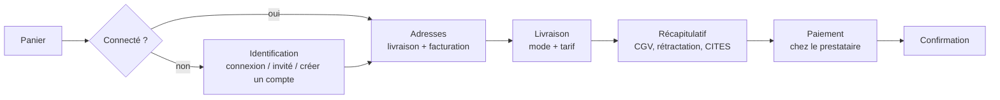
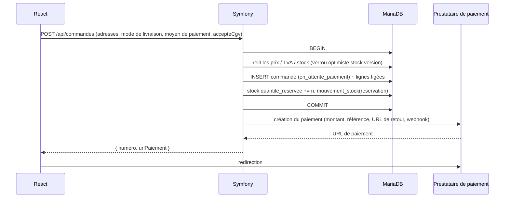

# 02 — Le tunnel de commande (checkout)

## 1. Les étapes



### Variantes d'interface

| Variante | Description | + | − |
|---|---|---|---|
| **Multi-pages** | une route React par étape (`/commande/adresses`, `/commande/livraison`…) | lisible, bouton « retour » natif | plus de clics |
| **Page unique en accordéon** ✅ | une seule page `/commande`, sections dépliées l'une après l'autre | moins d'abandons, tout reste visible | état plus complexe à gérer |
| **Paiement express** | Apple Pay / Google Pay / PayPal directement depuis le panier (l'adresse vient du portefeuille) | très rapide sur mobile | adresse imposée par le portefeuille ; frais de port à recalculer en direct |

Recommandé : **page unique** en v1, **paiement express** en v2.

## 2. Commande sans compte (invité)

Aujourd'hui `commande.utilisateur_id` est **NOT NULL**. Trois possibilités :

| Option | Modification | + | − |
|---|---|---|---|
| **Compte obligatoire** | aucune | rien à changer | 20 à 30 % d'abandons en plus (ordre de grandeur souvent cité) |
| **Invité pur** ✅ | `utilisateur_id` devient NULL + colonne `email` sur `commande` ; suivi de commande par lien signé | peu d'abandons | historique dispersé si le client revient |
| **Compte léger automatique** | création d'un `utilisateur` sans mot de passe (`is_verified = 0`) ; lien « définir mon mot de passe » | historique conservé | compte créé sans demande explicite (RGPD : à mentionner clairement) |

Recommandé : **invité**, puis sur la page de confirmation : « Créez votre compte en un clic pour suivre vos commandes » (le formulaire est déjà pré-rempli). Si un compte existe déjà avec cet e-mail, les commandes invité y sont **rattachées** quand l'e-mail est vérifié.

Modifications du schéma :
```sql
ALTER TABLE commande
  MODIFY utilisateur_id INT UNSIGNED NULL,
  ADD email VARCHAR(180) NOT NULL AFTER utilisateur_id,
  ADD telephone VARCHAR(30) NULL,
  ADD jeton_suivi BINARY(16) NOT NULL UNIQUE;   -- lien « suivre ma commande »
```
On garde **ON DELETE RESTRICT** (obligations comptables) ; en cas de suppression du compte, on anonymise plutôt que supprimer.

## 3. Adresses

- Carnet existant (`adresse`) pour les clients connectés ; formulaire libre pour les invités.
- Case « l'adresse de facturation est identique ».
- Champs **société** et **numéro de TVA** sur l'adresse de facturation (B2B : écoles de musique, ensembles, luthiers revendeurs). Le numéro de TVA est vérifié via **VIES** (service web de la Commission européenne) pour l'**autoliquidation** intracommunautaire (voir 06).
- Validation du code postal par pays (`symfony/intl` est déjà installé pour la liste des pays).
- Autocomplétion d'adresse (option) : API Google Places, Geoapify ou la base bpost. Gain d'ergonomie, mais coût et transfert de données personnelles à un tiers.
- Les adresses sont **copiées** en JSON dans la commande (déjà prévu).

## 4. Création de la commande et réservation du stock

C'est le moment le plus délicat : **le stock est réservé** pour une durée limitée.



Règles :
- Si une ligne n'est plus disponible ou si un prix a changé : **409 Conflict** avec le panier recalculé ; React l'affiche et redemande une confirmation.
- `OptimisticLockException` sur `stock` : on réessaie une fois, puis 409.
- Un même panier ne doit pas créer deux commandes (double clic) : clé d'**idempotence** (en-tête `Idempotency-Key` envoyé par React, ou contrainte unique `commande.panier_id` tant que la commande est en attente).
- Le panier est **vidé seulement après le paiement confirmé**. S'il est abandonné, le client peut retenter.

### Durée de réservation (D4)

| Moyen de paiement | Expiration proposée | Raison |
|---|---|---|
| Carte, Bancontact, Apple Pay, PayPal | **30 min** (déjà prévu dans le schéma) | le paiement est immédiat |
| Klarna / paiement en plusieurs fois | 60 min | parcours plus long |
| **Virement SEPA** | **3 à 5 jours ouvrables** | délai bancaire (instantané si le client utilise SCT Inst) |
| Réservation avec acompte (voir 04) | selon l'accord | |

Colonne à ajouter : `commande.expire_at DATETIME NULL`. La tâche planifiée « expiration » applique la transition `expirer` → `annulee` et libère le stock.

### Cas limite à traiter absolument

**Paiement reçu après l'expiration** (le client a mis 35 min à payer, la pièce unique a été rachetée entre-temps) :
1. Le webhook arrive alors que la commande est `annulee`.
2. Si le stock est encore disponible → on **réserve à nouveau** et on passe la commande à `payee`.
3. Sinon → **remboursement automatique**, e-mail d'excuse, alerte admin.

Pour limiter ce cas : demander au prestataire une **date d'expiration du paiement** égale à `expire_at` (Mollie : `expiresAt` sur certains moyens ; Stripe Checkout : `expires_at`, 30 min minimum).

## 5. Symfony Workflow pour la commande

Le schéma prévoit déjà les transitions via Workflow ; `config/packages/workflow.yaml` n'existe pas encore.

```yaml
# config/packages/workflow.yaml (proposition)
framework:
    workflows:
        commande:
            type: state_machine
            audit_trail: { enabled: true }
            marking_store: { type: method, property: statut }
            supports: [App\Entity\Commande]
            initial_marking: en_attente_paiement
            places: [en_attente_paiement, payee, en_preparation, expediee, livree, annulee, retournee, remboursee]
            transitions:
                payer:            { from: en_attente_paiement, to: payee }
                expirer:          { from: en_attente_paiement, to: annulee }
                annuler:          { from: [en_attente_paiement, payee, en_preparation], to: annulee }
                preparer:         { from: payee, to: en_preparation }
                expedier:         { from: en_preparation, to: expediee }
                livrer:           { from: expediee, to: livree }
                retourner:        { from: livree, to: retournee }
                rembourser:       { from: [annulee, retournee], to: remboursee }
```

Note : `marking_store` avec un enum PHP est pris en charge depuis Symfony 7.x (sinon un getter/setter `string`).

Les effets sur le stock et les e-mails sont placés dans des **écouteurs** `workflow.commande.completed.<transition>` :

| Transition | Stock | E-mail client | Autre |
|---|---|---|---|
| (création) | réservation | — | |
| `payer` | — | confirmation + facture | vider le panier, alerte admin « nouvelle commande », numéro de facture |
| `expirer` | libération | « votre commande a expiré » (option) | |
| `annuler` | libération | annulation | remboursement si déjà payée |
| `expedier` | sortie | « expédiée » + suivi | |
| `livrer` | — | demande d'avis (option) | début du délai de rétractation |
| `retourner` | retour (si revendable) | retour reçu | note de crédit |

Statut **`remboursee`** proposé en plus (ou bien seulement un champ `rembourse_at` et un `montant_rembourse` pour gérer les remboursements partiels).

## 6. Calcul des montants (service unique)

Un seul service, `CalculateurCommande`, utilisé **par le panier ET par la création de la commande** pour que les deux montants soient toujours identiques :

```
pour chaque ligne :
    prix_ttc_unitaire = arrondi(prix_ht × (1 + taux_tva / 10000))
    total_ttc_ligne   = prix_ttc_unitaire × quantite
sous_total_ttc = Σ total_ttc_ligne
remise_ttc     = code promo (plafonnée au sous-total)
frais_port_ttc = grille de livraison (voir 05)
total_ttc      = sous_total_ttc − remise_ttc + frais_port_ttc
total_tva      = Σ TVA par taux (ventilée par taux pour la facture)
```

Choix à fixer : **prix de référence HT ou TTC ?** Le schéma stocke `prix_ht`. Pour un site B2C, on affiche des prix TTC « ronds » (1 890,00 €) : si l'on part du HT, on obtient des TTC du genre 1 889,99 €. Deux solutions :
- stocker un **`prix_ttc`** de référence et en déduire le HT (habituel en B2C) ;
- garder `prix_ht` et laisser l'admin saisir le TTC dans EasyAdmin, qui calcule le HT.

Avec la **TVA OSS** (taux du pays du client, voir 06), un prix TTC fixe implique un HT variable selon le pays. Il faut décider : **prix TTC identique partout** (marge variable) ou **HT fixe** (TTC variable selon le pays). Le prix TTC identique est le plus courant et le plus simple à comprendre pour le client.

## 7. Consentements au récapitulatif

- Case **CGV** (obligatoire, non cochée par défaut), avec lien vers les CGV dans la langue du client. On enregistre `cgv_version` et `cgv_acceptees_at` sur la commande.
- Bouton final avec un libellé légal explicite : **« Commander avec obligation de paiement »** (exigé par le droit européen de la consommation).
- Information sur le **droit de rétractation** et ses exceptions (instrument sur mesure).
- Avertissement **CITES** si un instrument est concerné et que le pays de livraison est hors UE (voir 06).
- Case newsletter **séparée**, non cochée.

## 8. Après le paiement

- Page `/commande/confirmation/{numero}`. Elle **n'affirme jamais « payée » sur la seule base du retour du navigateur** : elle interroge `GET /api/commandes/{numero}` et affiche « paiement en cours de vérification » tant que le webhook n'est pas arrivé (attente de quelques secondes avec rafraîchissement).
- E-mails (Symfony Mailer + modèles Twig traduits) : confirmation, facture PDF, expédition, livraison.
- Espace client : liste des commandes, détail, téléchargement des factures, suivi du colis, demande de retour.

## 9. Décisions

- **D3** : invité + création de compte proposée après l'achat.
- **D4** : durée de réservation variable selon le moyen de paiement ; `expire_at` sur la commande.
- Prix de référence : **TTC identique dans toute l'UE** (à confirmer avec le comptable).
