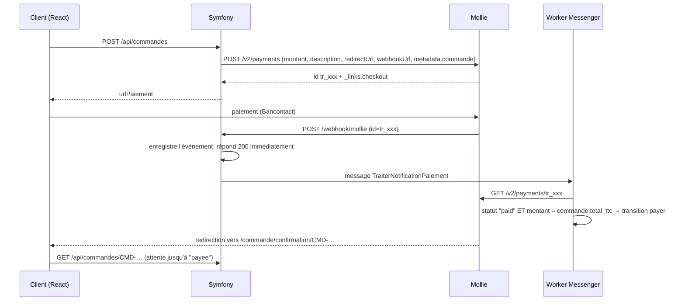

# 03 — Paiement en ligne

> Les commissions citées sont **indicatives** (ordre de grandeur pour un commerçant belge en 2026) et **à vérifier** sur les grilles officielles avant toute décision.

## 1. Moyens de paiement attendus par le public

| Moyen | Pertinence | Commentaire |
|---|---|---|
| **Bancontact** (carte et application Payconiq by Bancontact) | ★★★★★ BE | moyen de paiement préféré des Belges en ligne |
| **Cartes** Visa / Mastercard (+ Amex) | ★★★★★ | international, collectionneurs étrangers |
| **Apple Pay / Google Pay** | ★★★★ | mobile, paiement en un geste |
| **PayPal** | ★★★★ | rassurant pour les collectionneurs étrangers, courant sur Reverb et eBay |
| **iDEAL / Wero** | ★★★ NL | Pays-Bas ; Wero (initiative européenne EPI) remplace progressivement iDEAL et arrive en Belgique : à surveiller |
| **Virement SEPA** (avec QR code EPC) | ★★★★ pour les gros montants | frais quasi nuls ; habituel pour les pièces de collection |
| **Klarna / Alma / in3** (plusieurs fois) | ★★★ | utile pour les instruments entre 500 et 5 000 € |
| **Carte cadeau du site** | ★★ | voir 04 |
| Paiement à la livraison | ✗ | déconseillé (fragile, cher, risque de refus) |
| Crypto-monnaies | ✗ | aucun intérêt pour ce public |

## 2. Les prestataires (PSP)

### Mollie ✅ recommandé
- Société néerlandaise, très présente au Benelux. Tableau de bord en français.
- Bancontact, cartes, Apple Pay, Google Pay, PayPal (via le compte PayPal), iDEAL, Klarna, Billie (B2B), virement, cartes cadeaux, SEPA…
- **Sans abonnement**, paiement à la transaction. Ordre de grandeur : Bancontact ≈ 0,30 à 0,40 € fixe, cartes européennes ≈ 1,8 % + 0,25 €.
- Paiement hébergé (« Hosted Checkout ») ou **Mollie Components** (champs carte intégrés en iframe).
- SDK PHP officiel `mollie/mollie-api-php`. Il existe aussi un bundle Symfony communautaire, peu utile.
- Webhook **sans signature** : Mollie envoie seulement l'`id` du paiement et l'on **relit le statut via l'API**, ce qui garantit l'authenticité. Les nouvelles « Next-gen webhooks » sont signées.
- API **Orders** (abandonnée au profit de Payments avec `lines`) : utiliser l'**API Payments** avec les lignes de commande (exigées par Klarna).

### Stripe
- Américain (entité européenne en Irlande), le plus complet pour les développeurs.
- Bancontact, cartes, Apple Pay, Google Pay, Link, Klarna, SEPA, iDEAL, virement bancaire avec référence virtuelle…
- Ordre de grandeur : cartes de l'EEE ≈ 1,5 % + 0,25 €, Bancontact ≈ 0,35 € à 1,4 % selon la grille.
- **Stripe Checkout** (page hébergée) ou **Payment Element** (intégré). Webhooks **signés** (`Stripe-Signature`).
- Outils très pratiques : Stripe CLI pour recevoir les webhooks en local, Stripe Tax, Stripe Terminal (paiement en salon ou en boutique), Stripe Radar (antifraude).
- SDK `stripe/stripe-php`.

### PayPal (en direct)
- Inutile en direct si l'on passe par Mollie ou Stripe qui l'incluent.
- Commission plus élevée (≈ 2,9 à 3,5 % + fixe). Litiges fréquents en faveur de l'acheteur.

### Adyen
- Grands comptes, souvent avec un volume minimal. **Surdimensionné** pour ce projet.

### Viva Wallet (Viva.com), SumUp, Worldline (Ingenico)
- **Worldline / Ingenico** : acteur historique de Bancontact en Belgique ; offre e-commerce plus lourde à intégrer.
- **Viva.com** : banque européenne, tarifs agressifs, terminal Android ; API moins agréable.
- **SumUp** : intéressant si l'on vend aussi **en salon ou en atelier** (terminal de poche) ; e-commerce plus limité.

### Comparatif

| Critère | Mollie | Stripe | PayPal | Viva | Worldline |
|---|---|---|---|---|---|
| Bancontact | ✅ | ✅ | ❌ | ✅ | ✅ |
| PayPal inclus | ✅ | ✅ (selon le pays) | — | ❌ | ❌ |
| Klarna / plusieurs fois | ✅ | ✅ | Pay Later | partiel | ❌ |
| Simplicité d'intégration | ★★★★★ | ★★★★ | ★★★ | ★★★ | ★★ |
| Documentation et outils | ★★★★ | ★★★★★ | ★★★ | ★★★ | ★★ |
| Paiement physique (salon, atelier) | Mollie Point-of-sale | Stripe Terminal | Zettle | ✅ | ✅ |
| Interlocuteur au Benelux | ✅ | ~ | ~ | ~ | ✅ |
| Abonnement | aucun | aucun | aucun | aucun | souvent |

**D5 : Mollie**, Stripe en second choix (surtout si les ventes hors UE deviennent importantes ou si l'on veut Stripe Tax).

## 3. Modes d'intégration (D6)

| Mode | Fonctionnement | Conformité PCI DSS | Effort | Expérience client |
|---|---|---|---|---|
| **A. Redirection hébergée** ✅ v1 | Symfony crée le paiement → React redirige vers `checkout.mollie.com` → retour sur le site | **SAQ A** (le plus léger) | ★ | quitte le site un instant (habituel et rassurant) |
| **B. Composants intégrés** | champs carte en iframe du PSP dans la page React (Mollie Components, Stripe Payment Element) | SAQ A (iframe) | ★★★ | reste sur le site |
| **C. Formulaire carte maison** | le site reçoit le numéro de carte | SAQ D (lourd) | ★★★★★ | — |
| **D. Liens de paiement** | lien envoyé par e-mail depuis l'admin (Mollie Payment Links, Stripe Payment Links) | SAQ A | ★ | pour les ventes négociées (voir 04 « offre ») |

**C est exclu.** A en v1 ; B plus tard si les statistiques montrent des abandons sur la page du prestataire. **D est très utile** pour les ventes par téléphone ou par e-mail, fréquentes avec les collectionneurs.

3-D Secure / authentification forte (DSP2) : pris en charge par le prestataire dans les modes A, B et D.

## 4. Architecture côté Symfony

Ne pas lier le code métier à un SDK : on passe par un **adaptateur**.

```
src/Service/Paiement/
├── PrestatairePaiementInterface.php
│     creerPaiement(Commande, MoyenPaiement, urlRetour): PaiementCree   (id externe + URL)
│     recupererStatut(string idExterne): StatutPaiement
│     rembourser(Paiement, int montantCentimes, string motif): Remboursement
├── Mollie/MolliePrestataire.php
├── Stripe/StripePrestataire.php          (si besoin plus tard)
├── Virement/VirementPrestataire.php      (communication structurée + QR code EPC)
├── GestionnairePaiement.php              (choisit le prestataire, applique le Workflow)
└── Webhook/TraiterNotificationPaiementHandler.php   (Messenger, asynchrone)
```

Alternatives :
- **Payum** (`payum/payum-bundle`) : abstraction générique de nombreux PSP, mais maintenance irrégulière et API ancienne. **Déconseillé**.
- **Sylius PaymentBundle** isolé : difficile à extraire sans Sylius.
- **Symfony Webhook + RemoteEvent** (composant Symfony) : bonne base pour **recevoir** les webhooks (`#[AsRemoteEventConsumer]`), avec un `RequestParser` personnalisé pour Mollie. **Recommandé** pour la réception.

### Nouvelle table `paiement`

| Colonne | Type | Note |
|---|---|---|
| id | INT UNSIGNED PK | |
| commande_id | FK → commande, ON DELETE RESTRICT | une commande peut avoir **plusieurs tentatives** |
| prestataire | VARCHAR(20) | enum `mollie`, `stripe`, `virement`, `manuel` |
| moyen | VARCHAR(30) | `bancontact`, `carte`, `paypal`, `klarna`, `virement`… |
| id_externe | VARCHAR(100) UNIQUE NULL | `tr_xxx` (Mollie), `pi_xxx` (Stripe) |
| montant | INT UNSIGNED | centimes |
| devise | CHAR(3) | `EUR` |
| statut | VARCHAR(20) | `ouvert`, `en_attente`, `autorise`, `paye`, `echoue`, `annule`, `expire`, `rembourse`, `partiellement_rembourse` |
| reference_virement | VARCHAR(20) NULL | communication structurée belge `+++123/4567/89012+++` |
| donnees | JSON NULL | réponse brute utile (4 derniers chiffres, pays de la carte…) — **jamais** le numéro de carte |
| created_at, paye_at, updated_at | DATETIME | |

### Nouvelle table `remboursement`
`id`, `paiement_id`, `montant`, `motif`, `id_externe`, `statut`, `utilisateur_id` (admin qui l'a lancé), `created_at`.

### Table `evenement_webhook` (idempotence et audit)
`id`, `prestataire`, `id_evenement` (UNIQUE), `charge_utile` JSON, `recu_at`, `traite_at`, `erreur`. Un événement déjà traité est ignoré (les PSP **renvoient** les webhooks plusieurs fois).

## 5. Flux complet avec les webhooks



Règles d'or :
1. **La redirection de retour ne prouve rien** : seul le statut lu côté serveur fait foi.
2. Vérifier **le montant et la devise** reçus par rapport à la commande.
3. Webhook : répondre vite (200), traiter en **asynchrone**, gérer l'**idempotence**.
4. Route webhook **publique** (hors firewall), sans CSRF, protégée par la relecture via l'API (Mollie) ou par la **signature** (Stripe).
5. Journaliser (canal Monolog `paiement`).

### Développement local avec Docker
Le PSP doit pouvoir atteindre le webhook : utiliser un **tunnel** (`cloudflared tunnel`, `ngrok`, ou Stripe CLI `stripe listen --forward-to`). Autre solution en dev : une commande `app:paiement:synchroniser` qui interroge le statut des paiements ouverts (ce « polling » sert aussi de **filet de sécurité** en production, toutes les 15 min, si un webhook se perd).

### Préprod / prod
- Clés `MOLLIE_API_KEY` dans les **secrets Symfony** (`config/secrets/prod`) ou les variables d'environnement du VPS, jamais dans le dépôt (voir la tâche 017 « contrôle des secrets de déploiement »).
- Clé **test_** en préprod, **live_** en prod. Vérifier au démarrage que la prod n'utilise pas une clé de test.
- Le profil « Website » chez Mollie doit correspondre au domaine de prod (validation du site par Mollie : CGV, mentions légales et coordonnées visibles exigées).

## 6. Virement bancaire (gros montants)

Très pertinent pour les **instruments de collection** : une commission de 1,8 % sur 6 000 € coûte 108 €.

Deux variantes :
1. **Virement « manuel »** : la commande est créée en `en_attente_paiement` avec `expire_at = +5 jours ouvrables`. On affiche l'IBAN, la **communication structurée** (format belge `+++xxx/xxxx/xxxxx+++` avec modulo 97) et un **QR code EPC** (scannable par toutes les applications bancaires belges). L'admin valide la réception dans EasyAdmin (bouton « Marquer comme payée »), ou la validation est automatique grâce à un import **CODA** ou à une API bancaire (agrégateur PSD2 : Ponto, GoCardless Bank Account Data…).
2. **Virement via le PSP** (Mollie « Bank transfer », Stripe « customer balance ») : rapprochement automatique, mais avec une petite commission.

Seuil proposé : virement proposé **à partir de 500 €** ou seulement pour les pièces de collection (paramètre de configuration).

Génération du QR code : `endroid/qr-code` côté PHP, ou une petite bibliothèque JS côté React.

## 7. Paiement en plusieurs fois (D7)

| Service | Pays | Via | Commentaire |
|---|---|---|---|
| **Klarna** | BE, NL, FR, DE… | Mollie, Stripe | connu, frais commerçant élevés (≈ 3 à 5 %) |
| **Alma** | FR, BE, ES, IT, DE… | direct (et certains PSP) | 2x à 12x, populaire en France et en Belgique |
| **in3** | NL | Mollie | Pays-Bas uniquement |
| **Billie** | B2B | Mollie | facture à 30 jours pour les professionnels (écoles, conservatoires) |

Recommandé en **v2**, pour les instruments de plus de 300 €. Le crédit à la consommation est encadré (le prestataire assume l'obligation d'information, mais il faut éviter tout message trompeur du type « gratuit »).

## 8. Fraude et litiges

- 3-D Secure fait porter la responsabilité de la fraude carte par la banque émettrice : à imposer.
- Règles maison : alerte admin pour une **première commande > 2 000 €** expédiée **hors UE**, ou une adresse de livraison différente de celle de facturation dans un autre pays.
- Livraison des gros montants **avec signature** et **assurance** (voir 05) : seule preuve en cas de rétrofacturation (« chargeback »).
- Conserver les preuves : journaux, numéro de suivi, photo du colis avant envoi.

## 9. Remboursements

- Depuis EasyAdmin : action « Rembourser » (total ou partiel), avec montant et motif → `PrestatairePaiementInterface::rembourser()` → table `remboursement` → **note de crédit** (voir 06).
- Délai légal en cas de rétractation : **14 jours** après la notification, éventuellement après réception de l'objet retourné.
- Le remboursement se fait **sur le même moyen de paiement** (obligation légale, sauf accord du client).

## 10. Décisions

- **D5** : Mollie.
- **D6** : redirection hébergée en v1 ; liens de paiement pour les ventes négociées.
- **D7** : Klarna (ou Alma) en v2.
- Seuil du virement bancaire : à définir (500 € proposé).
