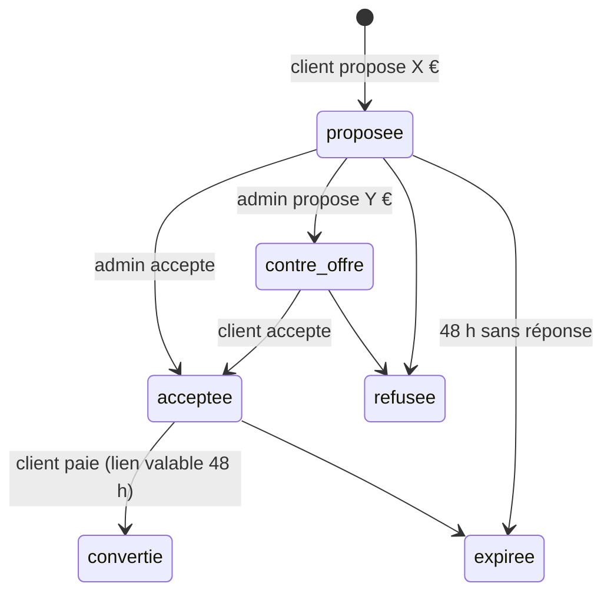

# 04 — Modèles de vente possibles

Le prix fixe en paiement immédiat est la base. Le public visé (passionnés, musiciens, **collectionneurs**, amateurs d'instruments **rares**) appelle aussi d'autres modes de vente. Chaque fiche indique son intérêt, son impact technique et sa priorité.

Légende : intérêt ★ à ★★★★★ · effort S / M / L / XL.

## Vue d'ensemble

| # | Modèle | Intérêt | Effort | Priorité proposée |
|---|---|---|---|---|
| 1 | Vente directe à prix fixe | ★★★★★ | M | **v1** |
| 2 | Pièce unique / collection | ★★★★★ | S | **v1** |
| 3 | Alerte « Prévenez-moi » (retour en stock, nouveauté) | ★★★★★ | S | **v1.1** |
| 4 | Liste de souhaits | ★★★★ | S | v1.1 |
| 5 | « Faire une offre » (négociation) | ★★★★ | M | **v2** |
| 6 | Réservation avec acompte | ★★★★ | M | **v2** |
| 7 | Vente sur demande / « prix sur demande » | ★★★★ | S | v2 |
| 8 | Précommande (fabrication à venir) | ★★★ | M | v2 |
| 9 | Commande sur mesure (luthier) | ★★★ | L | v3 |
| 10 | Essai en atelier / retrait sur place (click & collect) | ★★★ | S | v1.1 |
| 11 | Location / location-vente | ★★★ | XL | v3 |
| 12 | Dépôt-vente (instruments de particuliers) | ★★★ | L | v3 |
| 13 | Place de marché multi-luthiers | ★★ | XL | hors périmètre |
| 14 | Enchères | ★★ | XL | hors périmètre (ou via une plateforme) |
| 15 | Cartes cadeaux | ★★★ | M | v2 |
| 16 | Codes promo / soldes | ★★★ | M | v2 |
| 17 | Lots (« kit débutant » : instrument + étui + méthode) | ★★★ | M | v2 |
| 18 | Accessoires et consommables (cordes, peaux, anches) | ★★★★ | S | v1.1 |
| 19 | Abonnement (entretien, cordes, cours) | ★★ | L | v3 |
| 20 | Vente professionnelle (B2B, devis, facture différée) | ★★★ | M | v2 |
| 21 | Contenus numériques (partitions, méthodes, cours vidéo) | ★★ | M | v3 |

---

## 1. Vente directe à prix fixe
Déjà couverte par 01 → 03.

## 2. Pièce unique / collection
Déjà dans le schéma (`is_piece_unique`). À ajouter :
- fiche « certificat » : **provenance**, historique des propriétaires, restaurations, expertise (champ texte traduit ou PDF joint) ;
- photos haute définition, détails (signature du facteur, étiquette) ;
- après la vente : la fiche reste visible avec un bandeau **« Vendu »** (bon pour la crédibilité et le référencement), avec un bouton « Être averti d'une pièce similaire » ;
- stock bloqué à 1 par une contrainte `CHECK` ou par une validation.

Champs proposés : `instrument.statut_vente` (`disponible`, `reserve`, `vendu`, `sur_demande`, `bientot`) **calculé** à partir du stock, ou stocké pour l'affichage (`vendu` reste affiché).

## 3. Alerte « Prévenez-moi »
Table `alerte_disponibilite` (`instrument_id` NULL, `categorie_id` NULL, `email`, `locale`, `jeton_desinscription`, `created_at`, `notifie_at`).
- Retour en stock d'un instrument (écouteur sur `mouvement_stock` de type `entree`).
- **Nouvelle pièce dans une catégorie** (« Prévenez-moi des nouveaux ouds anciens ») : très apprécié des collectionneurs.
- Double opt-in (RGPD) pour les visiteurs non connectés.

## 4. Liste de souhaits
Même structure que le panier (01) avec un type `souhaits`, ou une table `favori` (`utilisateur_id`, `instrument_id`). Alerte si un favori **baisse de prix** ou **va être vendu** (option).

## 5. « Faire une offre »
Pratique courante dans le monde des instruments (Reverb, eBay « Meilleure offre »).

- Table `offre` : `instrument_id`, `utilisateur_id` (connexion obligatoire), `montant`, `contre_montant`, `statut`, `message`, `expire_at`.
- Option « prix plancher » caché (`instrument.prix_minimum_offre`) : acceptation ou refus **automatique**.
- À l'acceptation : une commande est créée au prix négocié et **le stock est réservé**, avec un **lien de paiement** (03 §3 D).
- Paramètre par instrument : `accepte_offres` (booléen).
- Workflow Symfony pour la machine à états.
- Garde-fous : limiter à 3 offres par client et par instrument, minimum de 50 % du prix.

## 6. Réservation avec acompte
Pour une pièce chère : le client verse **10 à 30 %** pour la bloquer, puis paie le solde (après un essai, à la livraison ou sous X jours).
- Deux paiements sur une même commande (la table `paiement` le permet déjà) ; type `acompte` / `solde`.
- Nouveau statut `reservee` (ou `acompte_paye`) dans le Workflow.
- Conditions de **remboursement de l'acompte** à écrire dans les CGV (juridiquement : distinguer **acompte** et **arrhes**, qui n'ont pas les mêmes effets en cas de désistement — à faire valider).
- Facture d'acompte obligatoire (TVA exigible à l'encaissement de l'acompte).

## 7. « Prix sur demande »
Pour les pièces exceptionnelles : pas de prix affiché, bouton « Demander le prix / prendre rendez-vous ». Formulaire de contact lié à l'instrument → e-mail à l'admin → **lien de paiement** ou commande créée par l'admin.
Champ : `instrument.mode_vente` (`en_ligne`, `sur_demande`, `vitrine` = exposé, non vendu).

## 8. Précommande
Instrument annoncé mais pas encore livré par le facteur.
- Option A : paiement total immédiat, livraison à la date annoncée (`instrument.disponible_le`).
- Option B : acompte (voir 6).
- Le stock peut être « négatif » de façon contrôlée : `stock.quantite_precommande_max`.
- Obligation d'informer clairement sur le **délai de livraison** ; au-delà de 30 jours sans accord, le client peut annuler.

## 9. Commande sur mesure
Instrument fabriqué selon le souhait du client (bois, accordage, gravure).
- Configurateur d'options (`option_instrument`, `valeur_option`, avec un supplément de prix) ou simple formulaire de **devis**.
- **Exception au droit de rétractation** (bien confectionné selon les spécifications du client).
- Paiement : acompte et solde (6).

## 10. Essai et retrait sur place (click & collect)
- Mode de livraison « **Retrait à l'atelier** » (frais : 0 €), avec un créneau de rendez-vous.
- « **Réserver pour essai** » : réservation gratuite de 48 h pour venir jouer de l'instrument (sans paiement, réservée aux comptes vérifiés, limitée à 2 à la fois).
- Paiement sur place : terminal (Mollie, SumUp, Stripe Terminal) relié à la même commande pour garder un stock exact.

## 11. Location et location-vente
Intéressant pour les **instruments d'étude** (débutants, enfants qui grandissent) : un mois de location, puis rachat avec déduction des loyers.
- Paiement récurrent : **mandat SEPA** ou carte enregistrée (Mollie « Subscriptions », Stripe « Billing »).
- Gestion des contrats, des cautions, des retours, de l'état à la restitution, de l'assurance… C'est un **métier à part entière**.
- Stock : l'instrument loué sort du stock vendable sans être vendu (nouveau type de mouvement `location`).
- **v3**, à faire seulement si la demande est confirmée.

## 12. Dépôt-vente
Des particuliers confient leur instrument ; le site le vend et prend une commission.
- Table `deposant`, contrat de dépôt, `instrument.deposant_id`, commission (%), reversement au déposant.
- Fiscalité : le **régime de la marge** s'applique souvent (06) ; reversements à tracer.
- Très adapté au marché des instruments anciens ; charge administrative modérée.

## 13. Place de marché multi-luthiers
Plusieurs vendeurs (luthiers, ateliers) publient sur le site.
- Paiements répartis entre vendeurs : **Stripe Connect** ou **Mollie Connect** (KYC des vendeurs, commission retenue à la source).
- Statut de **plateforme** au sens du DSA et de DAC7 (déclaration fiscale des revenus des vendeurs) : obligations lourdes.
- **Hors périmètre** : c'est un autre produit.

## 14. Enchères
- Enchères en ligne : synchronisation en temps réel (Mercure, également présent dans l'écosystème Symfony), anti-« sniping », vérification des enchérisseurs, frais acheteur…, avec un cadre légal spécifique pour les ventes publiques.
- Alternative réaliste : confier ponctuellement des pièces exceptionnelles à une **salle de ventes** spécialisée, ou publier sur eBay en mode enchères (07).

## 15. Cartes cadeaux
- Produit numérique (montant libre ou fixe) → code unique → moyen de paiement partiel au checkout.
- Table `carte_cadeau` (`code` haché, `solde`, `expire_at`) + `utilisation_carte_cadeau`.
- TVA : en Europe, un bon « **polyvalent** » n'est pas soumis à la TVA à l'émission mais à l'utilisation.
- Mollie gère aussi les cartes cadeaux de réseaux tiers (pas utile ici).

## 16. Codes promo et soldes
- Table `code_promo` : `code`, `type` (`pourcentage`, `montant`, `livraison_offerte`), `valeur`, `minimum_commande`, `debut_at`, `fin_at`, `utilisations_max`, `utilisations_par_client`, catégories éligibles.
- Exclure par défaut les **pièces uniques** (marge déjà étudiée).
- **Directive Omnibus** : toute annonce de réduction doit indiquer comme prix de référence **le prix le plus bas des 30 derniers jours** → il faut un **historique des prix** (`historique_prix` : `instrument_id`, `prix_ttc`, `debut_at`). À prévoir dès qu'on affiche des prix barrés.

## 17. Lots / kits
Un « kit débutant djembé » = djembé + housse + méthode. Table `lot` + `lot_composant` ; le stock disponible du lot = le minimum des composants. Utile avec les accessoires (18).

## 18. Accessoires et consommables
Cordes, peaux, anches, colophane, étuis, pièces détachées : **panier moyen plus faible mais achats répétés**. Ventes associées sur la fiche (« Cordes compatibles avec ce saz »). Table `instrument_accessoire` (relation N–N). Gestion du stock classique (quantités > 1).

## 19. Abonnement
Box de cordes trimestrielle, contrat d'entretien annuel, accès à des cours vidéo. Paiement récurrent (Mollie Subscriptions). **v3**, selon l'audience.

## 20. Vente aux professionnels (B2B)
Écoles de musique, académies, conservatoires, ensembles folkloriques, musées.
- Prix **HT** affichés pour les comptes professionnels (rôle `ROLE_PRO`, voter).
- Demande de **devis** → commande sur devis → paiement par **virement à 30 jours** (ou Billie).
- Numéro de TVA vérifié (VIES) ; autoliquidation intracommunautaire.
- En Belgique, **facture électronique Peppol obligatoire en B2B depuis le 01/01/2026** (06).

## 21. Contenus numériques
Partitions, méthodes PDF, cours vidéo. Livraison par lien de téléchargement signé et à durée limitée. TVA du pays du client (OSS). **Pas de droit de rétractation** si le client y renonce expressément avant le téléchargement. Faisable, mais c'est un autre métier.

---

## Impact sur le modèle de données (récapitulatif)

| Modèle | Nouvelles colonnes sur `instrument` | Nouvelles tables |
|---|---|---|
| 2 | `provenance` (traduite), `statut_vente` | — |
| 3 | — | `alerte_disponibilite` |
| 4 | — | `favori` |
| 5 | `accepte_offres`, `prix_minimum_offre` | `offre` |
| 6 | `acompte_pourcentage` | (`paiement.type`) |
| 7 | `mode_vente` | `demande_contact` |
| 8 | `disponible_le` | (`stock.quantite_precommande_max`) |
| 10 | `essai_possible` | `rendez_vous` |
| 12 | `deposant_id`, `commission` | `deposant`, `reversement` |
| 15 | — | `carte_cadeau`, `utilisation_carte_cadeau` |
| 16 | — | `code_promo`, `historique_prix` |
| 17 | — | `lot`, `lot_composant` |
| 18 | — | `instrument_accessoire` |

## D8 — Proposition

**v1** : 1, 2 · **v1.1** : 3, 4, 10, 18 · **v2** : 5, 6, 7, 15, 16, 20 · **v3 / selon la demande** : 8, 9, 11, 12, 19, 21 · **hors périmètre** : 13, 14.
