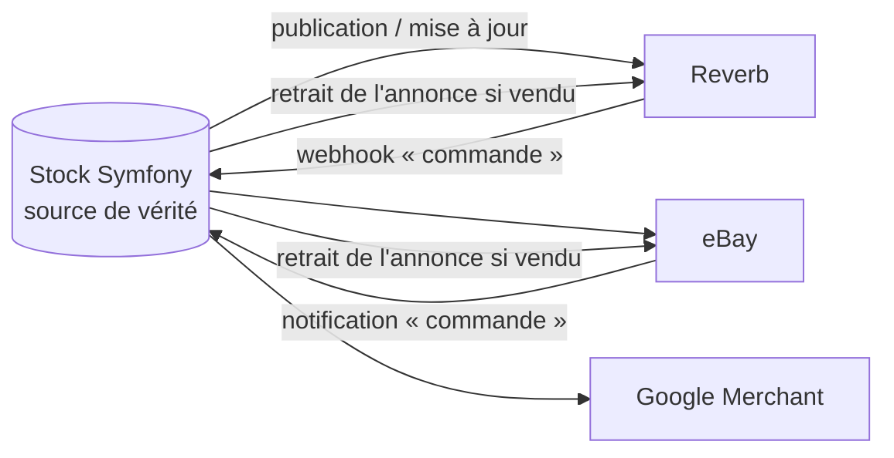

# 07 — Construire soi-même ou s'appuyer sur une solution existante, et canaux de vente externes

## 1. Construire soi-même ou non (D12)

Le dépôt dispose déjà de : catalogue multilingue, stock avec réservation et verrou optimiste, commandes figées, API Platform, back-office EasyAdmin, session partagée avec React, déploiement CI. **Une grande partie du socle e-commerce existe.**

| Option | Description | + | − | Verdict |
|---|---|---|---|---|
| **A. Développement maison** (Symfony + React) ✅ | les documents 01 à 06 | maîtrise totale, schéma adapté (pièce unique, CITES, marge), pas de licence, pédagogique | tout à construire : paiement, factures, e-mails, retours | **recommandé** |
| **B. Sylius** (e-commerce open source sur Symfony) | réécrire le catalogue dans Sylius, ou utiliser certains de ses bundles | panier, checkout, promotions, taxes, expédition, API Platform déjà faits | **migration du schéma**, courbe d'apprentissage importante, version de Symfony imposée, surdimensionné | seulement si l'on repart de zéro |
| **C. Shopware 6 / PrestaShop / WooCommerce en mode headless** | le back-end e-commerce est séparé, Symfony ne garde que la vitrine | fonctionnalités prêtes | double stack, synchronisation du stock, perte de l'intérêt du projet | non |
| **D. Shopify (Storefront API) / Shopify Buy Button** | Shopify gère panier, paiement, taxes ; React affiche le catalogue | paiement, TVA et fraude pris en charge | abonnement + commissions, catalogue en double, stock à synchroniser, dépendance | non, sauf pour un lancement très rapide |
| **E. Snipcart / Foxy.io** (panier JS « plug-in ») | panier ajouté au HTML, validation des prix par lecture de la page | intégration en quelques heures | commission, peu adapté à une SPA, stock géré à part | prototype seulement |
| **F. Stripe Checkout / Mollie Payment Links seuls**, sans panier | un bouton « Acheter » par instrument → page de paiement hébergée | très rapide pour un catalogue de pièces uniques | pas de panier multi-articles, frais de port peu flexibles | **solution transitoire possible** (voir §2) |

## 2. Solution transitoire « vendre dès maintenant »

Si l'on veut vendre **avant** que le panier soit terminé :

1. Bouton « Acheter » sur la fiche (pièce unique uniquement).
2. Symfony crée une commande d'un seul article + une **session de paiement hébergée** (Mollie / Stripe Checkout), avec choix du pays et frais de port forfaitaires.
3. Webhook → `payer` → e-mail.

C'est exactement la fin du tunnel décrit en 02/03 : **le travail n'est pas perdu**, on ajoute simplement le panier devant.

## 3. Canaux de vente externes (multicanal)

Les collectionneurs d'instruments fréquentent déjà certaines plateformes. Y être présent apporte de la visibilité, mais **le stock doit rester synchronisé** (surtout pour les pièces uniques).

| Canal | Public | Commission (ordre de grandeur) | API | Intérêt |
|---|---|---|---|---|
| **Reverb** | musiciens, collectionneurs d'instruments, international | ~5 % + frais de paiement | ✅ API REST (annonces, commandes) | ★★★★★ le plus ciblé |
| **eBay** (+ enchères) | large, collectionneurs | ~10 à 13 % | ✅ API Inventory / Fulfillment | ★★★★ |
| **Etsy** | artisanat, fait main, vintage | ~6,5 % + frais d'annonce + paiement | ✅ API v3 | ★★★ pour l'artisanat et le vintage |
| **2ememain / Marktplaats**, **Leboncoin**, **Vinted** | particuliers BE / NL / FR | variable | limitée ou absente | ★★ annonces manuelles |
| **Google Shopping (Merchant Center)** | recherche Google | gratuit (fiches gratuites) / payant (annonces) | flux XML / API Content | ★★★★ visibilité |
| **Facebook / Instagram Shop** | réseaux sociaux | variable | catalogue Meta | ★★ |
| Salons, festivals de musique traditionnelle, atelier | en personne | — | terminal de paiement | ★★★★ (voir 04 §10) |

### Synchronisation du stock

- Nouvelle table `annonce_externe` (`instrument_id`, `canal`, `id_externe`, `statut`, `synchronise_at`).
- Une vente sur Reverb crée une **commande** chez nous avec `canal = reverb` (nouvelle colonne `commande.canal`) → mouvement de stock → retrait automatique des autres canaux.
- Risque de **double vente** d'une pièce unique entre deux synchronisations : réduire le délai (webhooks plutôt que synchronisation périodique) et prévoir une procédure d'excuse et d'annulation.
- Alternative SaaS : agrégateurs multicanaux (ChannelEngine, Lengow…) : coûteux pour un petit catalogue.

**Recommandé :** flux **Google Merchant** (simple : un flux XML généré par Symfony) dès la v1, **Reverb** en v2 avec synchronisation par API. Les autres canaux restent manuels.

## 4. Services complémentaires (comparatif rapide)

| Besoin | Options | Recommandé |
|---|---|---|
| E-mails transactionnels | SMTP de l'hébergeur, Brevo (FR), Mailjet (FR), Postmark, Amazon SES | **Brevo** ou **Mailjet** (UE, `symfony/brevo-mailer`, `symfony/mailjet-mailer`) |
| Newsletter | Brevo, Mailchimp, listmonk (auto-hébergé) | Brevo (même outil) |
| Avis clients | interne, Trustpilot, Google Avis clients, Avis Vérifiés | **interne** (après livraison) ou Google Avis clients |
| Recherche catalogue | MariaDB `FULLTEXT`, Meilisearch, Algolia | MariaDB d'abord, Meilisearch si le catalogue grandit |
| Comptabilité | export CSV, Odoo, Billit, Exact Online, Yuki | à choisir **avec le comptable** (Peppol, OSS) |
| Antifraude | Radar (Stripe), règles Mollie, règles maison | règles maison (03 §8) |
| Analytics e-commerce | Matomo (auto-hébergé), Plausible | **Matomo** (entonnoir, e-commerce, sans cookie possible) |

## 5. Décision D12

**Développement maison**, car le socle est déjà là et le métier est particulier (pièces uniques, CITES, régime de la marge). On s'appuie sur des **services tiers** pour ce qui n'est pas le cœur du projet : paiement (Mollie), expédition (Sendcloud), e-mails (Brevo / Mailjet), comptabilité (logiciel du comptable).
