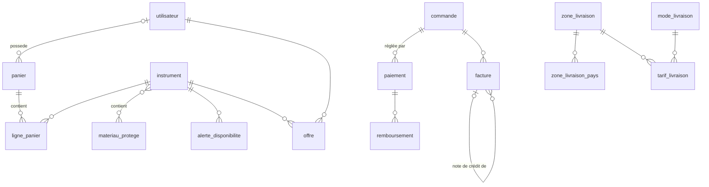

# 08 — Feuille de route proposée

Ordre de réalisation si les **recommandations** des documents 01 à 07 sont retenues. Chaque étape peut être livrée seule (branche + PR), dans le respect du cycle dev → préprod → prod.

Modèle Claude conseillé (selon `CLAUDE.md`) : **H** = Haiku, **S** = Sonnet, **O** = Opus.

## Phase 0 — Prérequis (décisions et socle)

| # | Tâche | Modèle |
|---|---|---|
| 0.1 | Valider les décisions D1 à D12 (README) | — |
| 0.2 | Rendez-vous avec le comptable : prix TTC ou HT, régime de la marge, OSS, outil de facturation, Peppol | — |
| 0.3 | Créer le compte Mollie (mode test) ; rédiger les mentions légales et les CGV provisoires (exigées pour l'activation) | — |
| 0.4 | Installer `symfony/scheduler`, `symfony/workflow`, `symfony/uid` ; prévoir le worker Messenger sur le VPS (cron) | S |
| 0.5 | `config/packages/workflow.yaml` (machine à états `commande`) + tests des transitions | S |

## Phase 1 — Panier (v1)

| # | Tâche | Modèle |
|---|---|---|
| 1.1 | Entités `Panier`, `LignePanier` + migration | H |
| 1.2 | `CalculateurPanier` (prix TTC, TVA, totaux) — **service partagé avec la commande** — + tests unitaires | S |
| 1.3 | Ressource API Platform `Panier` (Provider / Processor), cookie de jeton, `PanierVoter`, limitation de débit | O (sécurité) |
| 1.4 | Fusion visiteur → utilisateur sur `LoginSuccessEvent` + tests | S |
| 1.5 | React : `PanierContext`, `BoutonAjoutPanier`, mini-panier, page `/panier` | S |
| 1.6 | Tâche planifiée de purge des paniers visiteurs | H |

## Phase 2 — Tunnel de commande (v1)

| # | Tâche | Modèle |
|---|---|---|
| 2.1 | Migration `commande` : invité (`email`, `utilisateur_id` NULL), `expire_at`, `jeton_suivi`, `cgv_version`, `canal` | H |
| 2.2 | Livraison : `zone_livraison`, `mode_livraison`, `tarif_livraison`, `instrument.classe_livraison` + EasyAdmin | S |
| 2.3 | `POST /api/commandes` : transaction, réservation du stock, idempotence, réponses 409 | **O** (concurrence, argent) |
| 2.4 | Écouteurs du Workflow → `mouvement_stock`, e-mails | S |
| 2.5 | Expiration planifiée des commandes non payées (5 min) | S |
| 2.6 | React : page `/commande` (accordéon : identification, adresses, livraison, récapitulatif) | S |
| 2.7 | Espace client : mes commandes, suivi invité par lien signé | S |

## Phase 3 — Paiement (v1)

| # | Tâche | Modèle |
|---|---|---|
| 3.1 | Tables `paiement`, `remboursement`, `evenement_webhook` | H |
| 3.2 | `PrestatairePaiementInterface` + `MolliePrestataire` (paiement hébergé) | S |
| 3.3 | Réception des webhooks (Symfony Webhook / RemoteEvent) + traitement Messenger asynchrone + idempotence + vérification du montant | **O** |
| 3.4 | Cas « paiement après expiration » (nouvelle réservation ou remboursement automatique) | **O** |
| 3.5 | Virement SEPA : communication structurée, QR code EPC, validation manuelle dans EasyAdmin | S |
| 3.6 | Tâche de synchronisation des paiements ouverts (filet de sécurité) | S |
| 3.7 | Page de confirmation React (attente du statut réel) | S |
| 3.8 | Secrets Mollie en préprod et prod (test / live), contrôle au déploiement | S |

## Phase 4 — Factures et après-vente (v1, obligatoire avant la mise en production)

| # | Tâche | Modèle |
|---|---|---|
| 4.1 | Tables `facture`, `sequence_facture` ; numérotation continue sous verrou | **O** |
| 4.2 | PDF (dompdf) multilingue : régime normal, régime de la marge, autoliquidation | S |
| 4.3 | Remboursements et notes de crédit depuis EasyAdmin | S |
| 4.4 | Demande de retour depuis l'espace client | S |
| 4.5 | Pages légales versionnées (`document_legal`) + acceptation des CGV enregistrée | S |
| 4.6 | `regime_tva`, `prix_achat` (admin seulement), table des taux par pays | S |
| 4.7 | Matériaux CITES : tables, affichage, contrôle au checkout | S |
| 4.8 | Audit de sécurité complet du parcours d'achat | **O** |

→ **Mise en production de la vente en ligne.**

## Phase 5 — Fidélisation et confort (v1.1)

| # | Tâche | Modèle |
|---|---|---|
| 5.1 | Alertes « Prévenez-moi » (instrument / catégorie), double opt-in | S |
| 5.2 | Liste de souhaits | H |
| 5.3 | Accessoires et ventes associées | S |
| 5.4 | Retrait à l'atelier / réservation pour essai | S |
| 5.5 | Relance des paniers abandonnés | S |
| 5.6 | Flux Google Merchant | S |

## Phase 6 — Modes de vente avancés (v2)

| # | Tâche | Modèle |
|---|---|---|
| 6.1 | « Faire une offre » (Workflow `offre`, lien de paiement) | S |
| 6.2 | Réservation avec acompte (facture d'acompte, solde) | O |
| 6.3 | « Prix sur demande » + création de commande par l'admin | S |
| 6.4 | Codes promo + historique des prix (Omnibus) | S |
| 6.5 | Cartes cadeaux | S |
| 6.6 | Comptes professionnels, devis, VIES, autoliquidation | O |
| 6.7 | Paiement en plusieurs fois (Klarna / Alma) | S |
| 6.8 | Sendcloud (points relais, étiquettes, suivi) | S |
| 6.9 | Paiement express (Apple Pay / Google Pay) depuis le panier | S |
| 6.10 | Synchronisation Reverb | O |

## Phase 7 — Selon la demande (v3)

Précommande, commande sur mesure, dépôt-vente, location / location-vente, abonnements, contenus numériques.

---

## Récapitulatif des évolutions du schéma

| Table existante | Colonnes à ajouter |
|---|---|
| `instrument` | `regime_tva`, `prix_achat`, `classe_livraison`, colonnes `colis_*`, `code_sh`, `mode_vente`, `accepte_offres`, `prix_minimum_offre` (v2) |
| `commande` | `email`, `telephone`, `utilisateur_id` NULL, `expire_at`, `jeton_suivi`, `cgv_version`, `cgv_acceptees_at`, `canal`, `mode_livraison_id`, `valeur_assuree`, `remise_ttc`, `code_promo_id` (v2) |
| `ligne_commande` | `regime_tva`, `prix_unitaire_ttc` (affichage figé), `tva_marge` |
| `adresse` | `numero_tva` (B2B) |
| `utilisateur` | `newsletter_at`, `is_pro` / `ROLE_PRO` |

Nouvelles tables v1 : `panier`, `ligne_panier`, `paiement`, `remboursement`, `evenement_webhook`, `facture`, `sequence_facture`, `zone_livraison`, `zone_livraison_pays`, `mode_livraison`, `tarif_livraison`, `taux_tva_pays`, `materiau_protege`, `instrument_materiau_protege`, `document_legal`.

## Tests indispensables

- **Unitaires** : `CalculateurPanier` / `CalculateurCommande` (arrondis, plusieurs taux, régime de la marge, remise plafonnée, frais de port).
- **Fonctionnels (API)** : ajout au panier d'une pièce indisponible ; fusion de paniers ; création concurrente de deux commandes sur une pièce unique (une seule réussit) ; webhook rejoué deux fois (un seul effet) ; webhook avec un montant différent (refusé) ; paiement après expiration.
- **Workflow** : transitions interdites (`expedier` depuis `en_attente_paiement`).
- **Sécurité** : accès au panier ou à la commande d'un autre (voter) ; prix envoyé par le client ignoré.
- **E2E** (option) : Playwright sur le parcours complet avec la **clé de test Mollie**.

## Estimation grossière

| Phase | Charge (développeur seul, ordre de grandeur) |
|---|---|
| 0 | 1 à 2 j |
| 1 | 4 à 6 j |
| 2 | 6 à 8 j |
| 3 | 5 à 7 j |
| 4 | 6 à 8 j |
| **Total v1 vendable** | **≈ 4 à 6 semaines** |
| 5 | 1 à 2 semaines |
| 6 | 4 à 6 semaines |

Estimation indicative, hors rédaction juridique, traductions et photos.
